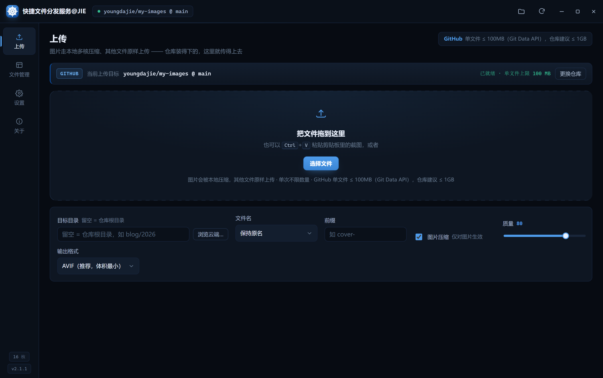
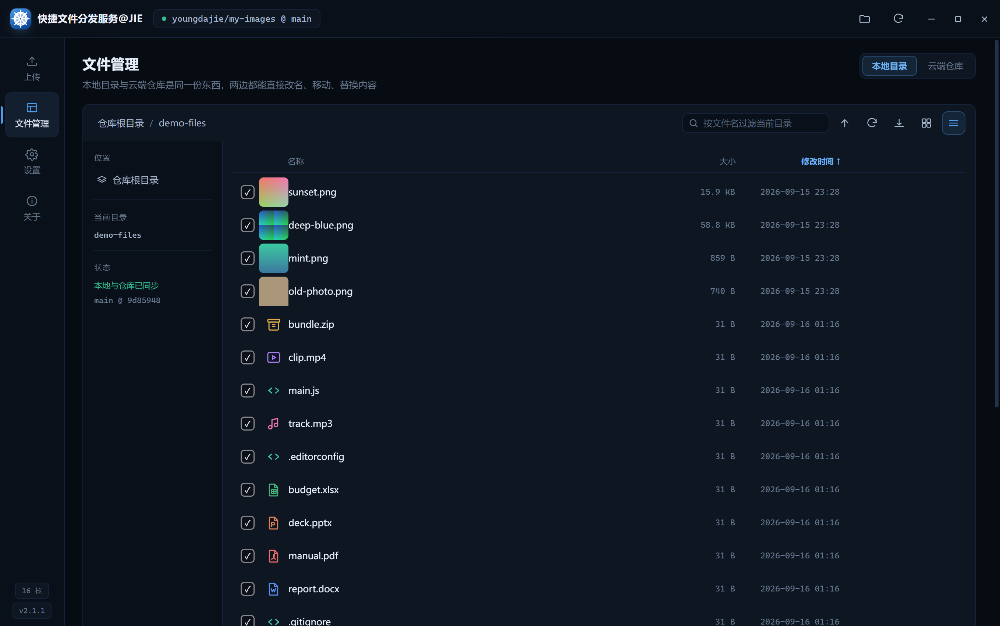
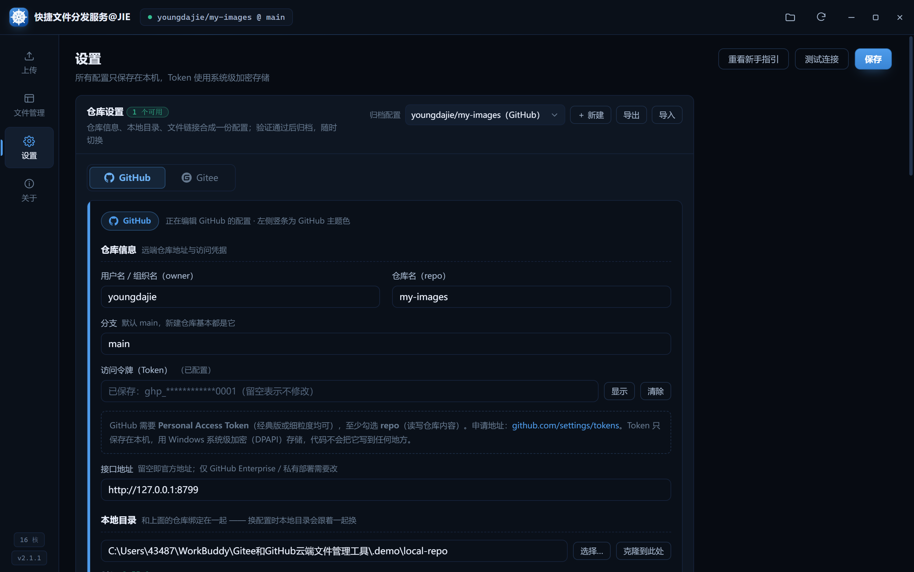
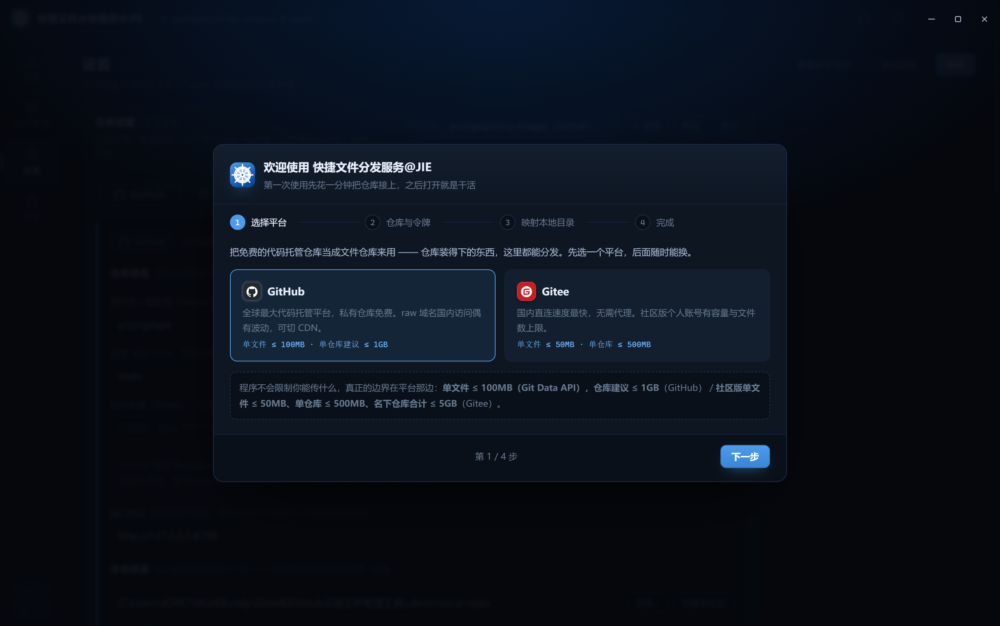

# 快捷文件分发服务 `@JIE`

<!--
  品牌里的 @JIE 一律用反引号包住，别裸写：
  平台会把裸写的 @JIE 当成对某位同名用户的「提及」，仓库页和发布页会多出一个指向他的链接。
  本项目的 @ 后面就是 JIE 三个字母，不是用户名。
-->

> 把免费的代码托管仓库当**文件仓库**用：图片在本地用多核 CPU 压缩好再推上去，其他文件原样上传，仓库装得下的东西都能从这里分发。

基于 **Electron** 的 Windows 桌面应用，同时支持 **GitHub** 与 **CNB**（cnb.cool）。灵感来自 [PicX](https://github.com/XPoet/picx)，但把这件事搬到本地用原生性能重做了一遍，并且不限于图片。

## 亮点

- **本机多核压缩** —— Web Worker 线程池 + OffscreenCanvas，线程数 = CPU 核心数；支持 PNG / JPEG / WebP / AVIF（默认），可调质量、尺寸、目标体积逼近、文本水印
- **不只是图片** —— 仓库装得下什么就管什么：上传、复制链接、重命名、移动、替换、删除
- **云端与本地是同一份** —— 仓库拉到本地，管理页直接读磁盘；改完点「提交并推送」，自动比对两边提交差异并提示该拉还是该推
- **双平台** —— GitHub（REST v3 + Git Data API）与 CNB（Open API + Git 提交）；Token 用 Windows DPAPI 系统级加密落盘
- **多份归档配置** —— 「仓库 + 本地目录 + 链接规则」存成一份配置，随时切换、导出、导入（连 Token 和链接设置一起带走）
- **界面** —— 深色 / 浅色主题一键换肤；下拉、取色盘、数字步进器全部自绘，不出现系统原生控件；字体枚举本机真实安装的全部字体，带关键字筛选；无边框窗口，自绘标题栏

## 截图

<p>
  
  
</p>
<p>
  
  
</p>

浅色主题、平台图层、自绘取色盘与字体筛选等更多截图见 [`docs/screenshots/`](docs/screenshots/)。

## 下载安装

到 [Releases](https://cnb.cool/youngdajie/Quick-FileDispatch/-/releases) 下载最新的 `QuickFileDispatch-Setup-x.x.x.exe`，双击安装即可。

- 系统要求：Windows 10 / 11（x64）
- 建议装好 [Git](https://git-scm.com/)（用于本地仓库同步；没装也能浏览云端，只是慢一些）
- 首次启动进入新手指引：选平台 → 填仓库与令牌（现场验证）→ 映射本地目录。右上角的 **❌** 可随时退出，之后能在设置页重新打开

> 安装包文件名固定为 ASCII 的 `QuickFileDispatch-Setup-x.x.x.exe`，装好后的快捷方式、开始菜单项、程序本体与卸载器都叫 **快捷文件分发服务`@JIE`**。

## 从源码运行

```bash
npm install
npm run dev       # 开发模式
npm run dist      # 打包 NSIS 安装包到 dist/
```

> 国内网络若遇 Electron 二进制下载缓慢：
> `ELECTRON_MIRROR=https://npmmirror.com/mirrors/electron/ npm install`

## 免费额度边界

程序本身不设限，越界的是仓库：

| | GitHub 免费账号 | CNB 社区版 |
| --- | --- | --- |
| 仓库数量 | 不限（公开 / 私有随意） | 公开不限，私有 5 个 |
| 单仓库容量 | 建议 ≤ 1 GB | Git 对象 100 GB |
| 单文件上限 | 100 MB | 200 MB |
| 国内直连 | raw 时好时坏，可套 jsDelivr | 快，可再套 JSDMirror |

> CNB 的仓库挂在**组织**下而不是个人名下，所以仓库标识要写成「组织名/仓库名」（例如 `youngdajie/cnb-files`），第一次用先去 cnb.cool 建一个组织。

## 测试

内置无头自检，不用手点也能回归主要链路：

```bash
electron . --selftest --uitest --fstest --shots   # 探针 + 界面交互 + 文件系统 + 截图
electron . --selftest                             # 也可只跑其中一项
```

`.demo/` 下另有一组离线单测（纯 Node，不联网、不碰真实账号），覆盖配置存储、链接规则、字体枚举、CNB 读写通道与云端检测器的 Git 原语。

## 致敬

如果没有 **PicX**（[github.com/XPoet/picx](https://github.com/XPoet/picx)，作者 XPoet），大概不会有这个程序。它对配置项的拆解、链接规则的整理、多级目录与批量操作的设计，都是本项目直接借鉴的对象。PicX 的 AGPL-3.0 授权与其作者，都值得被明确地写在这里。

## License

本项目采用 [MIT License](LICENSE)。

其中 `src/renderer/vendor/avif/` 下的 AVIF 编码器来自 [jSquash](https://github.com/jamsinclair/jSquash)，遵循 [Apache-2.0](src/renderer/vendor/avif/LICENSE)。

---

作者：[youngdajie](https://cnb.cool/youngdajie) · [yangjie.site](https://www.yangjie.site)
