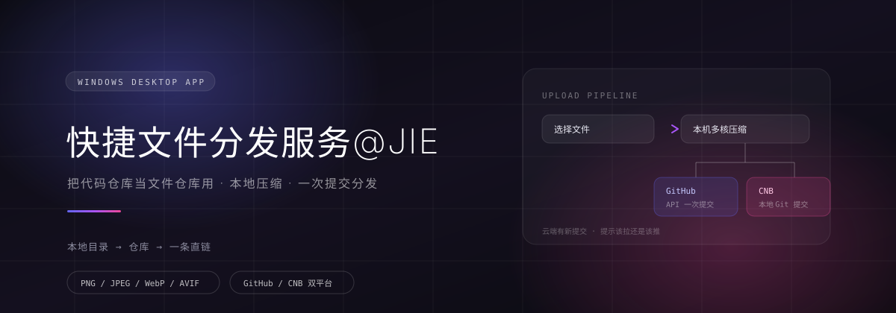

<!--
  品牌里的 @JIE 一律用反引号包住，别裸写：
  平台会把裸写的 @JIE 当成对某位同名用户的「提及」，仓库页和发布页会多出一个指向他的链接。
  本项目的 @ 后面就是 JIE 三个字母，不是用户名。
-->

<p align="center">
  
</p>

<p align="center">
  <a href="https://cnb.cool/youngdajie/Quick-FileDispatch/-/releases"><strong>⬇️ 下载安装</strong></a> ·
  <a href="https://cnb.cool/youngdajie/Quick-FileDispatch/-/releases">全部版本</a> ·
  <a href="./docs/screenshots">界面截图</a>
</p>

---

> **这条分支（`go`）是主线：Go 版。**
> 从 2.8.0 起，这个项目全面转向 **Go + WebView2**，不再更新 Electron 版。
> Electron 版定格在 **v2.8.0**，仍可从 Releases 下载，源码在 git 历史（v2.8.0 标签）里；
> 当前版本 **3.2.0** 功能完整，日常使用请用它。

## 它是什么

一个 Windows 桌面应用，把 GitHub / CNB 的免费代码仓库当**文件仓库**用。

把文件丢进去，它替你压好、提交上去，再给你一条能直接用的链接——图片在本地用多核 CPU 压缩，其他文件原样上传。仓库装得下的东西都能从这里分发。

```html
<!-- 压好、传上去、拿到链接，直接用 -->

```

思路参考 [PicX](https://github.com/XPoet/picx)：配置怎么拆、链接规则怎么定、目录怎么分级，都从那里学的。不一样的是压缩跑在本机（不是浏览器里排队），而且不限于图片。

## 工作原理

```text
选好一批文件
    │
    ├─ 图片  →  本机多核压缩：Web Worker 池（线程数 = CPU 核心）→ OffscreenCanvas
    └─ 其他  →  原样保留，一个字节都不动
    │
    ├─ GitHub  →  Git Data API，一次请求 = 一个提交，原子
    └─ CNB     →  写进本地克隆，git commit + git push
    │
    └─ 出链接  →  按链接规则拼成 纯链接 / Markdown / HTML / BBCode
```

- **本地和云端是同一份** —— 仓库克隆到本地后，管理页直接读磁盘，不走网络；上传、改名、移动、删除之后本地目录跟着变
- **改动都经过提交** —— 本地与云端的提交对不上时，界面会明说该拉还是该推，不会让你自己猜
- **令牌不进明文盘** —— Token 用 Windows DPAPI 按当前用户加密后才落盘

## 特性

| 能力 | 说明 |
| --- | --- |
| 本机多核压缩 | Web Worker 线程池 + OffscreenCanvas，线程数 = CPU 核心数，不占界面帧 |
| 压缩可调 | 质量、最长边、目标体积逼近，以及文字水印（位置 / 颜色 / 透明度可调） |
| 格式 | PNG / JPEG / WebP，AVIF 为默认（同体积下比 WebP 再小一截） |
| 不只是图片 | 压缩/水印只作用于图片，其余文件原样上传；上传、复制链接、重命名、移动、替换、删除都在一个页面里 |
| 文本就地看和改 | HTML / JS / CSS / JSON / Markdown / py / go / 各类配置文件直接双击打开，带语法着色；改完就地存回仓库，换行符、BOM 与编码原样保留（GBK 的老文件也能正常看）；预览框右上角一键甩到浏览器 |
| 本地与云端一致 | 管理页可切「本地目录 / 云端仓库」两个视角，同一个目录两种读法 |
| 双平台 | GitHub 与 CNB 都能用，同一套配置结构，随时切换 |
| 链接规则 | 四种输出格式 + 自定义链接前缀 + 可选图片代理（raw 直链被墙时兜底） |
| 多份归档配置 | 「仓库 + 本地目录 + 链接规则」存成一份配置，切换、导出、导入（令牌和链接设置一起带走） |
| 全程自绘界面 | 深色 / 浅色一键换肤；下拉、取色盘、数字步进器都是自绘的，不弹系统原生控件；字体下拉枚举本机真实装了的字体；无边框窗口 + 自绘标题栏 |

## 快速开始

### 1. 下载

到 [Releases](https://cnb.cool/youngdajie/Quick-FileDispatch/-/releases) 按需要挑一个：

| 版本 | 给谁 | 形态 |
| --- | --- | --- |
| **3.2.0**（Go 版，当前） | 日常用 | NSIS 安装包（约 7 MB）或免安装单 exe（约 15 MB） |
| **v2.8.0**（Electron 版，定格） | 备用 | `QuickFileDispatch-Setup-2.8.0.exe`，NSIS 安装包（106 MB） |

- 系统要求：Windows 10 / 11（x64）
- 建议装好 [Git](https://git-scm.com/)：本地同步要用它，没装也能浏览云端，只是慢一些

### 2. 填仓库和令牌

首次启动进新手指引：选平台 → 填仓库与令牌（当场联网验证）→ 映射本地目录。右上角的 **❌** 可以随时退出，之后能在设置页重新打开。

- **GitHub**：需要一枚 PAT（`repo` 权限），仓库填 `用户名/仓库名`
- **CNB**：仓库挂在**组织**下而不是个人名下，所以填 `组织名/仓库名`（例如 `youngdajie/cnb-files`），第一次用先去 cnb.cool 建一个组织

### 3. 绑定本地目录

克隆一份仓库到本地，填进设置页。绑上之后管理页读的是磁盘，改动最后靠「提交并推送」推回云端。

### 4. 从源码跑

Go 版（这条分支）：

```bash
go build -o qfd-go.exe .    # Go 1.24+，零第三方依赖
./qfd-go.exe                # 起一个 127.0.0.1 本地服务，并打开应用窗口
./qfd-go.exe --check        # 自检：逐通道探针 + 本地文件越界测试
bash tools/installer/build.sh   # 出 NSIS 安装包（需要 NSIS 与 rcedit）
```

Electron 版的源码定格在 v2.8.0 标签的 git 历史里。

## 技术栈

- **外壳**：Go，只用标准库（零第三方依赖）；渲染层用 `go:embed` 整个编进 exe
- **窗口**：WebView2 原生窗口（`internal/wvhost`，纯 syscall 驱动 COM，零依赖）——无边框 + 渲染层自绘标题栏，`-H=windowsgui` 双击不弹控制台
- **界面**：原生 ES Module + 手写 CSS，没有前端框架 —— 与 Electron 版是**同一份渲染层代码**，通过一个 `window.cloudpic` 接缝接到本机 127.0.0.1 服务上
- **压缩**：Web Worker 线程池 + OffscreenCanvas；AVIF 编码器来自 [jSquash](https://github.com/jamsinclair/jSquash)（Apache-2.0，见 `src/renderer/vendor/avif/`）
- **Git**：调用本机 `git` 命令行（克隆、比对、提交、推送），不打包 libgit2
- **平台接口**：GitHub REST v3 + Git Data API；CNB Open API + 本地 Git 提交
- **凭据**：Token 经 Windows DPAPI 加密后落盘
- **打包**：`tools/installer/build.sh` 一条龙 —— `go build`（windowsgui）→ rcedit 注入图标与版本信息 → NSIS 安装包（约 7 MB）
