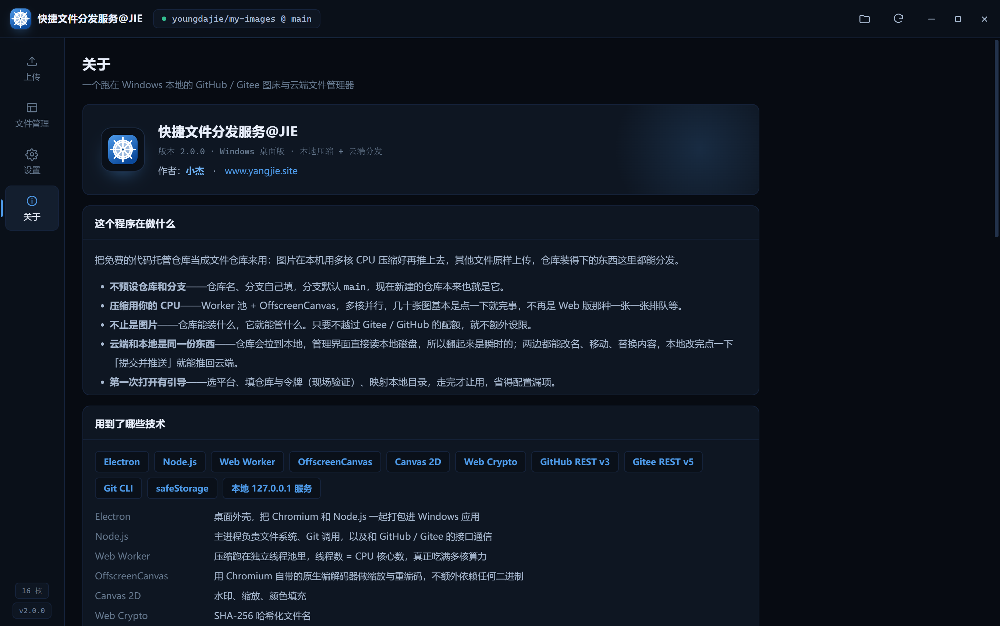

# 快捷文件分发服务 @JIE

> 把免费的代码托管仓库当**文件仓库**用：图片在本地用多核 CPU 压缩好再推上去，其他文件原样上传，仓库装得下的东西都能从这里分发。

一个基于 **Electron** 的 Windows 桌面应用，支持 **GitHub** 与 **Gitee** 两个平台。灵感来自 [PicX](https://github.com/XPoet/picx)（作者 XPoet），但换了个思路——把同一件事搬到本地，用原生性能重做一遍，并顺手补上「不只是图片」这件事。

---

## 为什么会有它

PicX 的思路很好（用 GitHub 仓库当图床），但已经停止维护，而且只能传图片。这个项目想要的是：

- **本机算力压缩**——几十张图并行处理，点一下就好，不再是网页版一张张排队等；
- **不限于图片**——仓库装得下什么，它就能管理什么；
- **云端和本地是同一份东西**——仓库拉到本地，管理界面直接读磁盘，翻起来是瞬时的，两边都能改、都能同步。

## 核心功能

| 能力 | 说明 |
| --- | --- |
| 📦 多平台分发 | GitHub（REST v3 + Git Data API）与 Gitee（REST v5）双平台，Token 用 Windows DPAPI 系统级加密保存 |
| 🖼️ 本地多核压缩 | Web Worker 线程池 + OffscreenCanvas，线程数 = CPU 核心数，支持质量 / 尺寸 / 格式转换 / 目标体积逼近 |
| 🎨 图片格式 | PNG / JPEG / **WebP** / **AVIF**（内置 WASM 编码器，AVIF 为默认格式） |
| 💧 水印 | 文本水印，可调位置、透明度、字号、颜色（色块 + 预设配色） |
| 🔗 链接规则 | 直链 / Markdown / HTML / BBCode 多种格式，支持自定义域名与 CDN 代理加速预览 |
| 🗂️ 文件管理 | 目录浏览 + 列表视图，多级目录，本地 / 云端双源切换 |
| ✏️ 文件操作 | 上传、复制链接、重命名、移动、替换内容、删除，本地改完一键「提交并推送」 |
| 🧭 多配置归档 | 可保存多份「仓库 + 本地目录」绑定配置，验证可用后归档，随时切换 |
| 🪟 无边框窗口 | 去掉系统标题栏，自绘窗口按钮，整窗 UI 统一 |

## 界面截图

无边框深色界面，四个页面：上传 / 文件管理 / 设置 / 关于。

<p>
  
  
</p>
<p>
  
  
</p>

- **上传**：拖拽或 <kbd>Ctrl</kbd>+<kbd>V</kbd> 进队列，本地多核压缩后推送
- **文件管理**：本地 / 云端双源浏览，列表视图 + 按类型着色的文件图标
- **设置**：平台切换、仓库配置归档、压缩与水印、链接规则、CDN 代理
- **关于**：技术栈、免费额度边界、快捷键

## 技术栈

| 技术 | 用途 |
| --- | --- |
| Electron | 桌面外壳，打包 Chromium + Node.js |
| Node.js | 主进程：文件系统、Git 调用、平台 API 通信 |
| Web Worker | 压缩线程池，按 CPU 核心数并行 |
| OffscreenCanvas | 用 Chromium 原生编解码器缩放与重编码，零原生依赖 |
| Canvas 2D | 水印、缩放、颜色填充 |
| Web Crypto | SHA-256 哈希化文件名 |
| GitHub REST v3 / Git Data API | 仓库读取、批量上传（一次提交搞定整批） |
| Gitee REST v5 | 国内直连，Contents 接口逐文件提交 |
| Git CLI | 把仓库拉到本地，本地目录与云端始终对齐 |
| safeStorage | Token 用 Windows DPAPI 系统级加密落盘 |
| 本地 127.0.0.1 服务 | 渲染层模块化 + 本地文件直出 + 私有仓库缩略图代取 |

## 环境要求

- **Windows 10 / 11（x64）**
- 已安装 [Git](https://git-scm.com/)（用于本地仓库同步，缺失时仍可浏览云端，只是速度较慢）

## 安装与运行

### 直接使用（免编译）

从 [Releases](../../releases) 下载最新的 `JIE-Dispatch Setup x.x.x.exe` 安装包，双击安装即可。

> 首次启动会进入**新手指引**：选平台 → 填仓库名与 Token（现场验证）→ 映射本地目录，走完即可使用。

### 从源码运行

```bash
# 1. 安装依赖
npm install

# 2. 开发模式启动（自动打开开发者工具）
npm run dev

# 3. 或直接启动
npm start
```

> 国内网络若遇 Electron 二进制下载缓慢，可设置镜像：
> `ELECTRON_MIRROR=https://npmmirror.com/mirrors/electron/ npm install`

### 打包为安装包

```bash
npm run dist          # 生成 NSIS 安装包到 dist/
npm run dist:dir      # 只生成免安装目录 dist/win-unpacked/
```

## 使用说明

1. **首次配置**：跟随新手指引，选择 GitHub 或 Gitee，填写仓库名、分支（默认 `main`）与访问令牌。
   - GitHub 需要 Personal Access Token，勾选 `repo` 权限；
   - Gitee 需要私人令牌，勾选 `projects` 权限。
2. **上传**：拖文件进窗口，或 `Ctrl+V` 粘贴剪贴板截图；图片会先本地压缩，其他文件原样上传。
3. **管理**：左侧「文件管理」页浏览文件，支持改名、移动、替换、删除；本地改完点「提交并推送」同步云端。
4. **链接**：选中文件复制对应格式的链接；预览走直链，可配置 CDN 代理加速。

## 免费额度边界

程序本身不设限，但仓库是第三方服务，越界会推不上去：

| 项目 | GitHub 免费账号 | Gitee 社区版（个人） |
| --- | --- | --- |
| 仓库数量 | 不限（公开 / 私有随意） | 最多 1000 个 |
| 单仓库容量 | 建议 ≤ 1 GB | ≤ 500 MB |
| 单文件上限 | 100 MB | 50 MB |
| 账号总容量 | 无硬性总容量 | ≤ 5 GB |
| 单文件建议 | ≤ 25 MB 最稳 | ≤ 20 MB 最稳 |
| 国内直连 | raw 时好时坏，可配 jsDelivr 等 CDN | 直连快 |

## 项目结构

```
src/
├── main/                  # 主进程
│   ├── main.js            # 窗口、IPC、自检设施
│   ├── platform.js        # GitHub / Gitee 统一客户端
│   ├── git.js             # 本地仓库同步（git CLI）
│   ├── store.js           # 配置存储（含多配置归档 + Token 加密）
│   ├── server.js          # 本地 127.0.0.1 静态服务
│   ├── local.js           # 本地文件操作
│   └── preload.js         # contextBridge 暴露的 IPC 接口
├── renderer/              # 渲染层
│   ├── index.html         # 单页骨架（上传 / 管理 / 设置 / 关于）
│   ├── css/app.css        # 全站样式（深色主题）
│   ├── js/app.js          # 路由 + 顶栏 + 窗口控制
│   ├── js/pages/          # 四个页面逻辑
│   ├── js/lib/            # 压缩引擎、链接规则、状态管理、UI 组件等
│   ├── assets/            # Logo
│   └── vendor/avif/       # AVIF WASM 编码器（Apache-2.0）
└── build/                 # 图标与生成脚本
```

## 自检与测试

项目内置一套无头自检设施，无需人工点按即可回归主要链路：

```bash
# 完整自检（探针 + 界面交互 + 文件系统 + 截图）
electron . --selftest --uitest --fstest --shots

# 单独跑某一部分
electron . --selftest     # 渲染层探针
electron . --uitest       # 设置页交互断言
electron . --fstest       # 文件系统增删改查
electron . --shots        # 生成界面截图
```

自检会用到 `.demo/` 目录下的 mock API 与假仓库，可用 `--profile=<dir>` 指定独立配置目录避免污染真实配置。

## 致敬

如果没有 **PicX**，大概不会有这个程序。PicX（[github.com/XPoet/picx](https://github.com/XPoet/picx)，作者 XPoet）最早把「用 GitHub 仓库当图床」这件事做得足够简单、完整，它对配置项的拆解、对链接规则的整理、对多级目录和批量操作的设计，都是本项目直接借鉴的对象。PicX 的 AGPL-3.0 授权与其作者，都值得被明确地写在这里。

## License

本项目采用 [MIT License](LICENSE)。

其中 `src/renderer/vendor/avif/` 下的 AVIF 编码器来自 [jsquash/avif](https://github.com/jamsinclair/jSquash)，遵循 [Apache-2.0](src/renderer/vendor/avif/LICENSE)。

---

作者：[小杰](https://www.yangjie.site)
